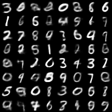
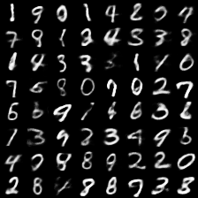

# MLX Vision Experiments

Benchmarks and generative model experiments comparing Apple MLX with PyTorch MPS on Apple Silicon. No CUDA. No cloud GPUs. Everything runs natively on the same unified memory architecture Apple ships in every device.

---

## Results Summary

| Experiment | Apple MLX | PyTorch MPS | MLX Advantage |
|---|---|---|---|
| MLP (3-layer, Milestone 1.1) | 0.0509s/epoch | 0.0611s/epoch | **1.2x faster** |
| VAE on MNIST (Milestone 1.2) | 0.902s/epoch | 3.460s/epoch | **3.84x faster**¹ |
| VAE memory | 25.29 MB | 64.66 MB | Not comparable² |
| DDPM on CIFAR-10 ([separate repo](https://github.com/ai-Priest/ddpm-apple-mlx-vs-pytorch-mps)) | 118.72s/epoch (M1 Max) | 150.03s/epoch (M1 Max) | **1.26x faster** on M1 Max; PyTorch 1.15x faster on M4 |

¹ End-to-end training time, including each script's data pipeline. The pipelines differ (see [Benchmark caveats](#benchmark-caveats)), so this is not a pure framework comparison.
² The two scripts read memory through different APIs. See [Benchmark caveats](#benchmark-caveats).

---

## Milestone 1.1 — MLP Speed Benchmark

`src/test_speed.py` benchmarks a 3-layer MLP training loop in both frameworks.

### Results

| Metric | PyTorch MPS | Apple MLX |
|---|---|---|
| Training time (per epoch) | 0.0611s | 0.0509s |
| Memory at end of run (current allocation) | 26.25 MB | 27.92 MB |

MLX takes **16.7% less time** per epoch (1.2x throughput). Both scripts keep their data on the GPU and synchronise before stopping the timer, so this is the cleanest comparison in the repo. Memory is read once at the end of the run in both frameworks, not as a true peak, and is effectively equal at this scale.

### Technical Note — Why No `@mx.compile`

`@mx.compile` with stateful `nn.Module` instances in MLX 0.31.0 requires `functools.partial` with explicit state threading to avoid incorrect computation graphs. For these benchmarks, it is omitted entirely. Plain MLX still dispatches all operations to the Metal GPU natively — `@mx.compile` would add complexity with minimal gain at this model size.

---

## Milestone 1.2 — VAE Generative Model Benchmark

`src/vae_mlx.py` and `src/vae_pytorch_mps.py` implement an identical Variational Autoencoder architecture trained on MNIST, with the same batch size, optimiser and epochs. The data pipelines are not identical; see [Benchmark caveats](#benchmark-caveats).

### Architecture

```
Encoder: 784 → 512 → 256 → (mu, logvar)  latent_dim=20
Decoder:  20 → 256 → 512 → 784 (sigmoid output)
Loss:     BCE reconstruction + KL divergence, averaged over batch
```

### Results

| Metric | Apple MLX | PyTorch MPS | Winner |
|---|---|---|---|
| Avg time per epoch (steady state) | 0.902s | 3.460s | MLX ✅ 3.84x faster (end to end) |
| Memory reading | 25.29 MB (live arrays) | 64.66 MB (driver pool) | Not comparable |
| Metal warmup (epoch 1) | 1.565s | 4.849s | MLX ✅ |
| Loss at epoch 10 | 119.09 | 103.68 | PyTorch 13% lower* |

*The two loss functions are mathematically the same (BCE + KL, summed per image, averaged over the batch); MLX clips outputs to [1e-7, 1 − 1e-7] and PyTorch clamps the log at −100, which should not produce a gap this size. The cause has not been investigated. Both models generate recognisable digits.

**On this VAE on an M1 Max, the MLX script trains 3.84x faster end to end than the PyTorch MPS script.** Part of that gap comes from the data pipeline rather than the framework.

### Generated Samples

Both grids below were generated by sampling z from the prior p(z) = N(0, I) — the encoder is never called at inference time.

**Apple MLX output (`vae_mlx_generated.png`):**



**PyTorch MPS output (`vae_pytorch_mps_generated.png`):**



### Why the VAE Gap Is Larger Than the MLP Gap

The MLP benchmark (1.2x) keeps all data on the GPU in both frameworks. The VAE benchmark (3.84x) does not, and that is the most likely reason the gap widens.

- The PyTorch script reads MNIST through a `DataLoader` that converts each image with `ToTensor()` on the CPU, then copies every batch to the GPU with `.to(device)`.
- The MLX script converts the whole dataset to one array before training and slices batches from it. MLX arrays live in unified memory, so there is no device copy.

Framework differences may also contribute (MLX's lazy evaluation versus PyTorch's eager MPS execution), but this benchmark does not isolate them. A fair framework-only comparison would preload MNIST as a GPU tensor in the PyTorch script too.

### Benchmark Caveats

- **Data pipeline.** As above, the VAE timings include each script's data loading, which differs between the two.
- **Memory.** `vae_mlx.py` reports `mx.get_active_memory()`, which counts live arrays only. `vae_pytorch_mps.py` reports `torch.mps.driver_allocated_memory()`, which counts the whole Metal driver pool, including PyTorch's cache. The two numbers measure different things and cannot be compared; `torch.mps.current_allocated_memory()` is the closer PyTorch equivalent. The DDPM repo documents the same mismatch at a larger scale.
- **One run each.** Each figure comes from a single run on one machine.

---

## Hardware & Environment

| Config | Details |
|---|---|
| Machine | Apple M1 Max Mac Studio |
| Memory | 32GB Unified Memory |
| OS | macOS (March 2026, fresh install) |
| Package Manager | Miniforge arm64 |
| MLX | 0.31.0 |
| PyTorch | MPS backend |
| Python | 3.11 (conda env: apple\_ai) |

---

## Why MLX vs PyTorch MPS

CUDA benchmarks are irrelevant for Apple Silicon deployment. This repo benchmarks what actually matters for on-device Apple ML workloads: MLX versus PyTorch's own MPS backend, both running natively on the same unified memory architecture.

The findings so far: MLX was faster on both small models here, by 1.2x on the MLP and 3.84x end to end on the VAE (where data loading also differs). The gap did not keep growing with model size. On a from-scratch diffusion model ([ddpm-apple-mlx-vs-pytorch-mps](https://github.com/ai-Priest/ddpm-apple-mlx-vs-pytorch-mps)), MLX led by 26% on an M1 Max, and PyTorch MPS led by 15% on an M4.

Any Apple engineer can clone this repo and reproduce results on their own Mac in under 5 minutes.

---

## Repository Structure

```
mlx-vision-experiments/
├── README.md
├── data/MNIST/raw/              # MNIST, committed so runs need no download
├── benchmark_results/
│   └── m1max_benchmark.md       # Full benchmark card with raw numbers
├── src/
│   ├── test_speed.py            # Milestone 1.1: MLP speed benchmark
│   ├── vae_mlx.py               # Milestone 1.2: VAE in Apple MLX
│   └── vae_pytorch_mps.py       # Milestone 1.2: VAE in PyTorch MPS
└── assets/
    └── generated_samples/
        ├── vae_mlx_generated.png
        └── vae_pytorch_mps_generated.png
```

---

## How to Reproduce

```bash
git clone https://github.com/ai-Priest/mlx-vision-experiments
cd mlx-vision-experiments
conda create -n apple_ai python=3.11
conda activate apple_ai
pip install mlx torch torchvision pillow

# Milestone 1.1 — MLP benchmark
python src/test_speed.py

# Milestone 1.2 — VAE benchmark
python src/vae_mlx.py
python src/vae_pytorch_mps.py
```

Results print to terminal. Generated images save to `assets/generated_samples/`.
